# Loan Default Prediction System

A reproducible MLOps reference project for estimating the probability of loan default from borrower and loan application attributes. It demonstrates data validation/versioning, comparable model experiments, a registry-based champion/challenger decision, an API, request logging, drift monitoring, and a manually approved retraining path. The output is a risk signal for human review, not an automated credit decision or a substitute for regulatory, fairness, privacy, or model-risk review.

## Architecture and end-to-end flow

```mermaid
flowchart LR
  A[Kaggle CSV] --> B[DVC versioned raw data]
  B --> C[Prepare: duplicate and plausibility filtering]
  C --> D[Stratified train/test split]
  D --> E[Sklearn preprocessing + LR / RF / XGBoost]
  E --> F[MLflow runs, metrics, plots and model versions]
  F --> G[Champion/challenger alias decision]
  G --> H[FastAPI probability and risk band]
  H --> I[JSONL request and prediction log]
  I --> J[Evidently drift report]
  J -->|drift or manual request| K[DVC retraining workflow]
  K --> L[GitHub Environment approval]
  L --> G
```



The source CSV has no date column, so the pipeline uses a stratified random split rather than a time split. The fitted imputation, scaling, encoding, and classifier are saved together as one scikit-learn Pipeline so training and serving apply identical preprocessing.

## Dataset and limitations

The supplied file is the public Kaggle **Credit Risk Dataset** (`credit_risk_dataset.csv`), with 32,581 rows and 12 columns. The target is `loan_status` (1 means default). It is a public, likely simulated/curated educational dataset, not genuine bank account or loan data. It is imbalanced (about 21.8% defaults) and includes missing employment length and interest rate values, exact duplicate records, and implausible ages/employment lengths. Cleaning drops duplicates, retains configured ages, and removes employment histories longer than age minus the configured minimum working age. It does not impute; imputers are fitted inside the sklearn pipeline. Income capping is configurable and off by default.

The dataset is not representative of any lender's current applicants, carries no time dimension, and does not establish causal relationships. A production credit-risk process would need data provenance, privacy and consent controls, fairness and adverse-impact assessment, calibration and threshold validation, explainability, legal/compliance review, and ongoing outcome monitoring before decisions could be made from its scores.

## Local setup

Use Python 3.11 for the pinned deployment environment. From the repository root:

```bash
python3.11 -m venv .venv
source .venv/bin/activate
python -m pip install --upgrade pip
pip install -r requirements.txt
cp .env.example .env
set -a && source .env && set +a
```

The `.env` file is local-only and must not be committed. The defaults use a SQLite MLflow backend and a local DVC remote. To initialize DVC on a fresh clone, use `dvc init`; then configure the local remote from the environment template:

```bash
dvc remote add --local -d storage "$DVC_REMOTE_URL"
dvc status
```

The repository's raw dataset is represented by a committed DVC pointer (`data/raw/credit_risk_dataset.csv.dvc`); materialize it with `dvc pull` if it is not already present. For this delivered copy the original CSV is included in the DVC cache. To use S3 or another DVC-supported store, set `DVC_REMOTE_URL` to that remote and configure its credentials in the shell or GitHub Secrets. For example, for S3 configure `AWS_ACCESS_KEY_ID`, `AWS_SECRET_ACCESS_KEY`, and `AWS_DEFAULT_REGION`; do not store keys in Git. DagsHub and Google Drive remotes require their provider-specific DVC configuration and authentication; change the remote URL and provide credentials through the provider-supported secure mechanism.

## Run the full pipeline

The project declares `prepare -> train -> evaluate` in `dvc.yaml`. Run:

```bash
dvc repro
```

`prepare` writes cleaned records. `train` performs a stratified split, fits each configured model, logs metrics/plots/confusion matrices and full pipelines to MLflow, and registers each trained pipeline as a model version. `evaluate` scores the selected best run on the held-out set and writes the DVC metric file. Change a model setting under `models` or a cleaning/split parameter under `data` in `params.yaml`, then rerun `dvc repro`: DVC compares stage parameters and dependencies and re-executes affected stages. Because model training changes the split and registered model, training and evaluation rerun for training-related parameter changes.

Create cumulative stratified data snapshots for a demo and version them independently:

```bash
python -m src.make_batches
dvc add data/batches/version_1.csv data/batches/version_2.csv data/batches/version_3.csv
git add data/batches/*.dvc && git commit -m "Version stratified data batches"
```

The configured batch fractions default to 60%, 20%, and 20%; each later snapshot adds its next disjoint partition to the earlier rows. Move between committed data versions with `git checkout <commit-or-branch>` followed by `dvc checkout`. Commit the DVC pointer and `dvc.lock` files to Git; `dvc push` uploads cached data to the configured remote. Each MLflow model version is tagged with the raw dataset's DVC content hash (`data_version`) and the Git commit (or `working-tree` when there is no commit), linking the model back to its code/data snapshot.

## MLflow experiments and controlled promotion

The default tracking URI is `sqlite:///mlflow.db` and the experiment is named in `params.yaml`. Start the local UI in another terminal:

```bash
mlflow ui --backend-store-uri "$MLFLOW_TRACKING_URI" --host 0.0.0.0 --port "$MLFLOW_PORT"
```

Open `http://localhost:5000` when using the default port. Each experiment run logs the configured classifier parameters, ROC-AUC, PR-AUC, KS statistic, precision/recall/F1 at the configured threshold, confusion-matrix JSON, ROC/PR plots, and the full preprocessing/model pipeline. The model is selected and compared using `registry.selection_metric`.

After a successful pipeline run, evaluate promotion:

```bash
python -m src.promote
```

The first candidate becomes the `champion` alias when no champion exists. A later candidate becomes champion only if it clears `registry.metric_promotion_margin` in the configured direction; otherwise it is assigned the `challenger` alias. When a stronger candidate replaces a champion, the prior champion becomes challenger. For a deliberate second comparison among this training run's registered candidates, invoke `python -m src.promote --version <version>` with a version shown in `reports/training_summary.json`. This project uses aliases, not deprecated registry stages.

## Prediction API

Start the service after a champion alias exists:

```bash
uvicorn app.main:app --host "$API_HOST" --port "$API_PORT"
```

Example single request (the feature keys and their categories/ranges are generated from `params.yaml`):

```bash
curl -sS -X POST "http://localhost:${API_PORT}/predict" \
  -H 'Content-Type: application/json' \
  -d '{"person_age":30,"person_income":50000,"person_home_ownership":"RENT","person_emp_length":5,"loan_intent":"EDUCATION","loan_grade":"B","loan_amnt":10000,"loan_int_rate":11.5,"loan_percent_income":0.2,"cb_person_default_on_file":"N","cb_person_cred_hist_length":5}'
```

Other configured endpoints are `GET /health`, `POST /predict/batch` (a JSON array of prediction objects), `GET /model-info`, and `POST /reload-model`. Invalid ranges or unconfigured categorical values receive a 422 response. If no champion can be loaded, health reports `degraded` and prediction/model-info return a service-unavailable response; after a promotion, `/reload-model` loads the new alias without restarting the process. Predictions include probability, risk band, and a threshold-based decision flag; the flag is a configurable signal, not a lending decision. Successful prediction requests are appended to the configured JSONL log with timestamp, model version, run ID, and data-version tag.

## Drift monitoring

Monitor compares training-reference inputs with request inputs in the JSONL file using Evidently 0.4.40. It writes an HTML report and a JSON decision summary:

```bash
python -m src.monitor
```

Too few observations produces an HTML explanation and a machine-readable `insufficient_data` status without a false positive. To demonstrate a clean sample first, clear the log and append examples sampled from the training reference; then simulate shifted income/interest-rate requests and rerun monitoring:

```bash
rm -f "$LOG_FILE"
python -m src.simulate_drift --clean
python -m src.monitor
rm -f "$LOG_FILE"
python -m src.simulate_drift
python -m src.monitor
```

The default drift simulation deliberately shifts configured income and interest-rate fields and writes schema-shaped JSONL records. It does not need a live API. The report path, summary path, minimum row count, drift-share threshold, and perturbation sizes are configurable in `params.yaml`.

## Docker Compose

Docker Engine and the Compose plugin are required. Compose starts the MLflow tracking server and API, with shared named volumes for the registry/artifacts and request logs. The initial API health response can be degraded until a model is trained and promoted.

```bash
cp .env.example .env
set -a && source .env && set +a
docker compose up --build -d
docker compose ps
```

Train against the supplied data through the API container (which is configured to log to the MLflow container), promote, reload, and verify:

```bash
docker compose exec api dvc repro
docker compose exec api python -m src.promote
# If this deployment already had a champion and the candidate qualified, reload it:
curl -sS -X POST "http://localhost:${API_PORT}/reload-model"
curl -sS "http://localhost:${API_PORT}/health"
curl -sS "http://localhost:${API_PORT}/model-info"
curl -sS -X POST "http://localhost:${API_PORT}/predict" -H 'Content-Type: application/json' \
  -d '{"person_age":30,"person_income":50000,"person_home_ownership":"RENT","person_emp_length":5,"loan_intent":"EDUCATION","loan_grade":"B","loan_amnt":10000,"loan_int_rate":11.5,"loan_percent_income":0.2,"cb_person_default_on_file":"N","cb_person_cred_hist_length":5}'
docker compose down
```

The MLflow UI is available on the configured `MLFLOW_PORT`; the API is exposed on `API_PORT`. Compose uses `MLFLOW_BACKEND_STORE_URI` and `MLFLOW_ARTIFACT_ROOT` for durable registry state. Docker volumes persist across `docker compose down`; use `docker compose down -v` only when you intentionally want to erase model registry, artifact, and log data.

## GitHub Actions and approval gate

`ci.yml` runs on push and pull request: pinned dependency install, Ruff, fixture-based training, pytest with temporary/local tracking, Docker image build, and GHCR publication only for pushes to `main` using `GITHUB_TOKEN`. `retrain.yml` has a weekly schedule (edit the workflow's `cron` expression to change the schedule) and a manual `workflow_dispatch` option. It pulls DVC data, monitors drift, retrains only when drift is detected or manual `force_retrain` is selected, pushes updated DVC outputs, and waits at the `model-production` GitHub Environment before promotion. To make the approval real, create that Environment in repository settings and configure required reviewers.

Configure these GitHub repository secrets for remote operations: `MLFLOW_TRACKING_URI` pointing to a shared MLflow tracking server, `DVC_REMOTE_URL`, and credentials for the chosen remote (for S3, `AWS_ACCESS_KEY_ID`, `AWS_SECRET_ACCESS_KEY`, and `AWS_DEFAULT_REGION`). For DagsHub, use the provider's supported DVC authentication and adapt the credential setup step accordingly. GHCR publication on `main` uses the workflow-provided `GITHUB_TOKEN`. No Actions runner or live external registry is required by the local test suite. The weekly schedule is a static cron value in GitHub Actions; edit it in the workflow to change cadence.

## Configuration reference

All project-specific settings live in `params.yaml`; `src/config.py` is the shared loader used by every stage and the API.

| Section | Keys | Purpose |
|---|---|---|
| `project` | `name`, `target_column`, `positive_class`, `feature_columns`, `numeric_features`, `categorical_features`, `categories`, `value_ranges`, `target_values` | Project identity, target/positive label, dynamic input schema, allowed categories and numeric bounds. |
| `data` | `raw_path`, `processed_path`, `batches_dir`, `batch_fractions`, `random_seed`, `min_age`, `max_age`, `minimum_working_age`, `age_column`, `employment_length_column`, `income_column`, `interest_rate_column`, `income_cap_enabled`, `income_cap_quantile`, `test_size`, `missing_indicator`, `train_path`, `test_path` | Source/output paths, cleaning rules, batch composition, split, seed, and imputation-indicator setting. |
| `models` | `selected`, `selection_metric`, `decision_threshold`; under each selected model: `class_path`, `imbalance_parameter`, `parameters` | Classifier classes and hyperparameters, class-imbalance strategy, metric used for candidate ranking, and operating threshold. |
| `registry` | `tracking_uri`, `experiment_name`, `model_name`, `champion_alias`, `challenger_alias`, `selection_metric`, `metric_direction`, `metric_promotion_margin` | MLflow tracking/registry names and guarded champion update policy. |
| `api` | `host`, `port`, `routes`, `risk_bands`, `request_log_path` | Bind settings, endpoint paths, risk-band labels/cutoffs, and request-log destination. |
| `monitoring` | `reference_path`, `current_log_path`, `report_path`, `summary_path`, `minimum_rows`, `drift_share_threshold`, `income_shift_multiplier`, `interest_rate_shift`, `api_url`, `sample_limit`, `evidently_shap_enabled` | Drift data locations, sample requirements, detection threshold, demo shifts, and sample cap. |
| `paths` | `metrics_path`, `training_summary_path`, `mlflow_artifact_path`, `dvc_remote_url` | Pipeline output and artifact/remote paths. |

The complete variable list is in `.env.example`: `MLFLOW_TRACKING_URI`, `MLFLOW_PORT`, `MLFLOW_BACKEND_STORE_URI`, `MLFLOW_ARTIFACT_ROOT`, `API_HOST`, `API_PORT`, `API_URL`, `HEALTH_PATH`, `LOG_FILE`, and `DVC_REMOTE_URL`. The raw dataset path is a DVC dependency configured at `data.raw_path` in `params.yaml`. In GitHub Actions, remote-only secrets are `AWS_ACCESS_KEY_ID`, `AWS_SECRET_ACCESS_KEY`, and `AWS_DEFAULT_REGION`; a shared `MLFLOW_TRACKING_URI` and remote `DVC_REMOTE_URL` are also repository secrets. Never commit `.env` or credentials.

## Troubleshooting

| Symptom | Checks |
|---|---|
| `dvc pull` cannot find data | Check that the DVC remote URL and credentials match the committed remote configuration; then run `dvc status` and `dvc checkout`. The provided copy includes the original data in its cache. |
| DVC says a dependency is missing | Confirm the raw CSV exists at `data.raw_path` and that the committed DVC pointer is checked out. |
| MLflow cannot register a model | Confirm the tracking URI points to a backend supporting the model registry (SQLite is used locally), and that the same URI is used by training, promotion, and API. |
| API health is degraded | Train at least one model, run `python -m src.promote`, then call the configured reload endpoint. Check MLflow URI reachability and registry aliases. |
| Prediction returns 422 | Check that all configured features are present, numeric values respect `project.value_ranges`, and categorical values are listed under `project.categories`. |
| Drift report says insufficient data | The current log must contain at least `monitoring.minimum_rows` valid feature records. |
| Docker API starts before a champion exists | This is expected; train and promote inside the API container, then call reload. Confirm the MLflow service is healthy and the shared volume is mounted. |
| CI drift/retrain job has no remote data | Configure `DVC_REMOTE_URL`, the remote credential secrets, `MLFLOW_TRACKING_URI`, and the `model-production` environment/reviewers. |

For a file-by-file explanation see [`docs/FILE_GUIDE.md`](docs/FILE_GUIDE.md). For the viva walkthrough see [`docs/DEMO_SCRIPT.md`](docs/DEMO_SCRIPT.md).
